# PlantUML Diagrams for AI Environmental Impact Analyzer

This document contains PlantUML code for various diagrams representing the system architecture, flow, and components of the AI Environmental Impact Analyzer project. You can copy these code blocks and render them using a PlantUML viewer (like the VS Code extension or the online PlantUML server).

## 1. Use Case Diagram
Shows the system's actors and their interactions with the system.

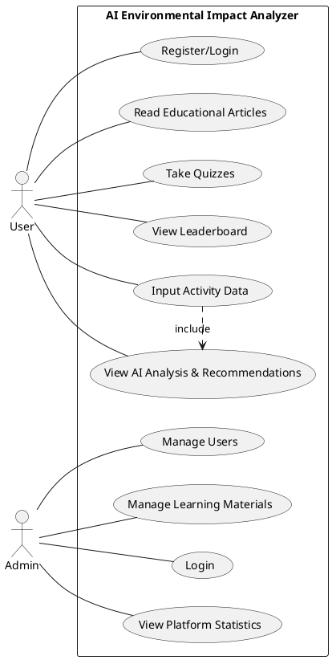

## 2. Entity Relationship Diagram (ERD)
Visualizes the database schema and relationships between collections in MongoDB.

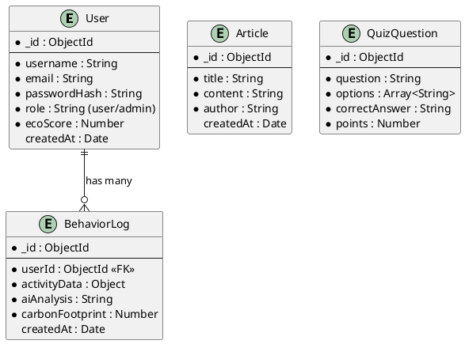

### Data Dictionary
While the ERD visually shows the relationships and fields, a Data Dictionary provides a tabular breakdown of the database schema. You can include these tables in your project documentation.

#### Collection: User
| Field Name | Data Type | Constraints | Description |
| :--- | :--- | :--- | :--- |
| `_id` | ObjectId | Primary Key | Unique identifier for the user |
| `username` | String | Required | Display name of the user |
| `email` | String | Required, Unique | User's email address for login |
| `passwordHash` | String | Required | Encrypted password |
| `role` | String | Default: 'user' | Defines permissions (`user` or `admin`) |
| `ecoScore` | Number | Default: 0 | User's accumulated gamification points |
| `createdAt` | Date | Auto-generated | Timestamp of account creation |

#### Collection: BehaviorLog
| Field Name | Data Type | Constraints | Description |
| :--- | :--- | :--- | :--- |
| `_id` | ObjectId | Primary Key | Unique identifier for the log |
| `userId` | ObjectId | Foreign Key | References the `User` collection |
| `activityData` | Object | Required | JSON object containing transport, diet, energy data |
| `aiAnalysis` | String | Required | The generated feedback from Gemini API |
| `carbonFootprint`| Number | Required | The calculated numeric footprint value |
| `createdAt` | Date | Auto-generated | Timestamp of the analysis request |

#### Collection: Article
| Field Name | Data Type | Constraints | Description |
| :--- | :--- | :--- | :--- |
| `_id` | ObjectId | Primary Key | Unique identifier for the article |
| `title` | String | Required | Title of the educational article |
| `content` | String | Required | Main body text/markdown of the article |
| `author` | String | Optional | Admin or author who created it |
| `createdAt` | Date | Auto-generated | Timestamp of creation |

#### Collection: QuizQuestion
| Field Name | Data Type | Constraints | Description |
| :--- | :--- | :--- | :--- |
| `_id` | ObjectId | Primary Key | Unique identifier for the question |
| `question` | String | Required | The quiz question text |
| `options` | Array<String> | Required, min 2 | List of possible answers |
| `correctAnswer` | String | Required | The exact string matching the correct option |
| `points` | Number | Default: 10 | Points awarded for a correct answer |

## 3. Data Flow Diagram (Level 0 Context Diagram)
Shows the high-level flow of information between the system and external entities. PlantUML doesn't have a strict DFD mode, but we can represent it using components.

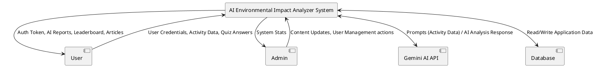

### Data Flow Diagram (Level 1)
Breaks down the main system into primary sub-processes.

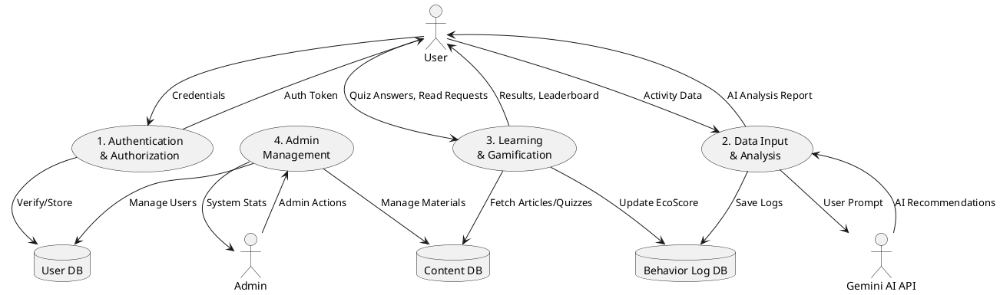

## 4. Architecture Diagram
Shows the high-level structure of the application.

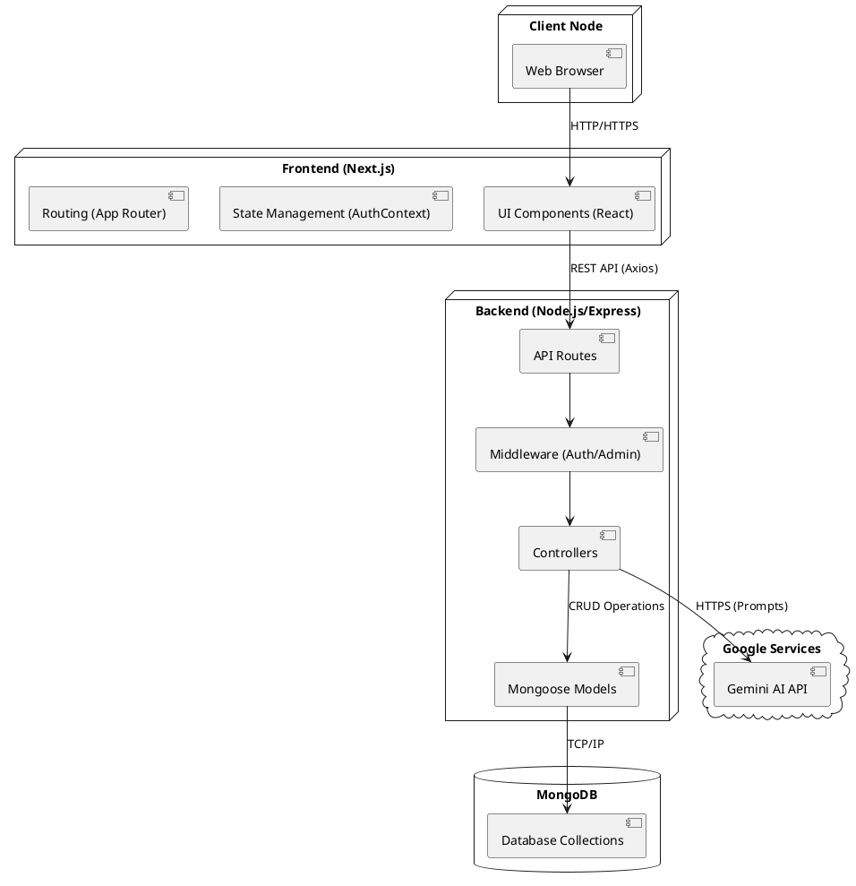

## 5. Class Diagram
Represents the structural design of the backend models and controllers.

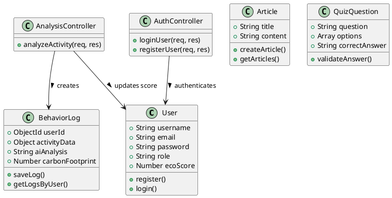

## 6. Sequence Diagram
Demonstrates the workflow for a User Analysis Request.

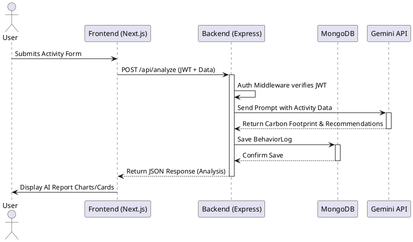

## 7. Activity Diagram
Visualizes the flow of the AI Analysis process.

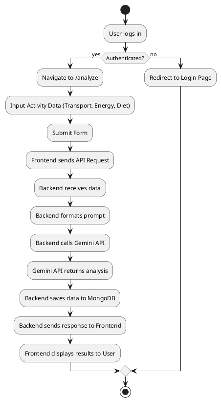

## 8. State Transition Diagram
Shows the states of a user session.

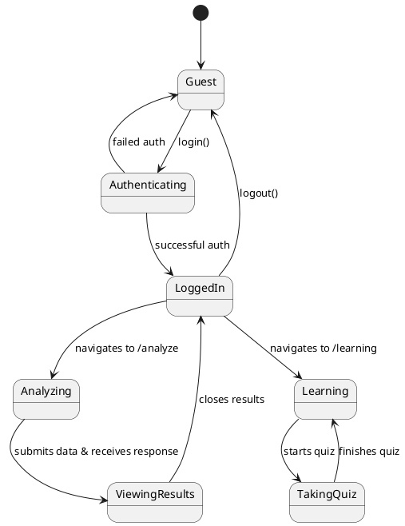

## 9. Component Diagram
Shows the structural relationship between system components.

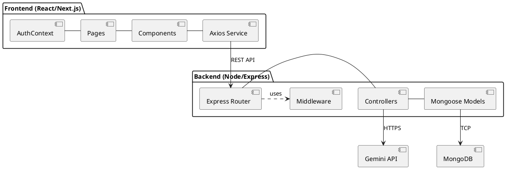

## 10. Deployment Diagram
Illustrates the physical deployment of the application.

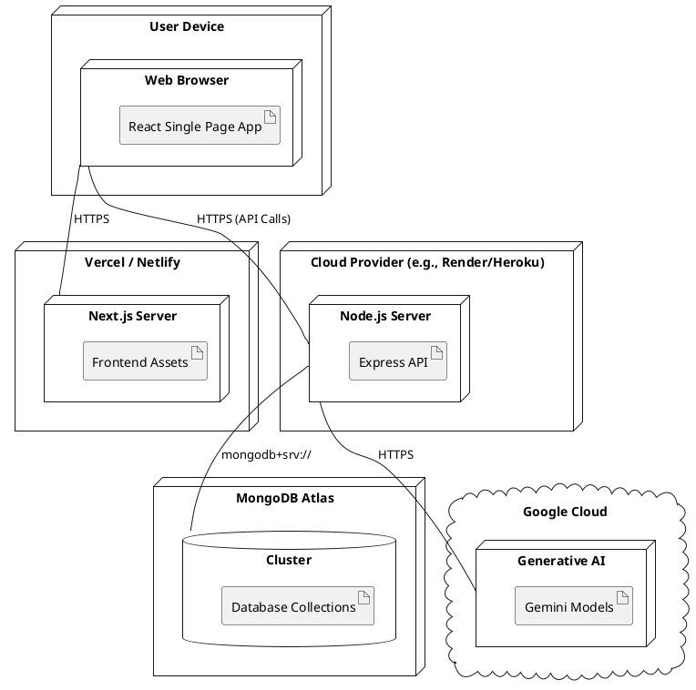

## 11. Collaboration (Communication) Diagram
Similar to sequence diagram but focuses on object relationships for the Login process.

```plantuml
@startuml
object "User UI : LoginPage" as ui
object "Auth Controller : AuthController" as authCtrl
object "User Model : User" as userModel
object "Database : MongoDB" as db

ui -> authCtrl : 1. POST /login (email, pass)
authCtrl -> userModel : 2. findOne({email})
userModel -> db : 3. query
db -> userModel : 4. return document
userModel -> authCtrl : 5. document instance
authCtrl -> authCtrl : 6. bcrypt.compare(pass, hash)
authCtrl -> authCtrl : 7. generate JWT
authCtrl -> ui : 8. 200 OK + Token
@enduml
```

## 12. Database Architecture Tiers
These diagrams illustrate the structural differences between 1-tier, 2-tier, and 3-tier application/database architectures. Our AI Environmental Impact Analyzer project utilizes a **3-tier architecture**.

### 1-Tier Architecture
Everything (UI, Logic, Data) is contained within a single machine/environment. Not typically used for web applications.

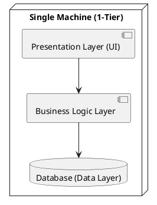

### 2-Tier Architecture
Client-Server model where the client directly communicates with the database server. Logic can be on either side.

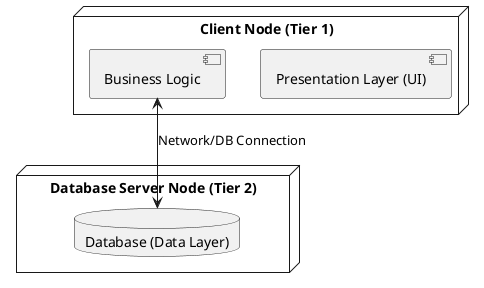

### 3-Tier Architecture
The standard web application model, separating UI, Logic, and Data into distinct tiers.

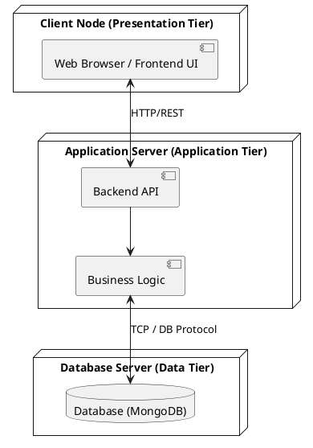
